## Sobre mim

Sou Software Engineer com foco em backend Java e Spring Boot. Atuo no Bradesco, pela Avanade, no grupo de Preço, squad de Consignado, evoluindo APIs e criando novos microsserviços em ambiente regulado.

- Arquitetura multi-tenant, Arquitetura Hexagonal, Clean Architecture e DDD
- Mensageria com Apache Kafka e RabbitMQ
- Cloud Azure (AKS) e AWS (EC2, Lambda e RDS)
- CI/CD, testes automatizados e sustentação de produção

## Como eu construo

## Tecnologias

## Projeto em destaque

**[Events-Microservice](https://github.com/gabriel-allencar/Events-Microservice)**: cria e lista eventos, registra participantes e solicita a confirmação por e-mail via Feign.
